<div align="center">

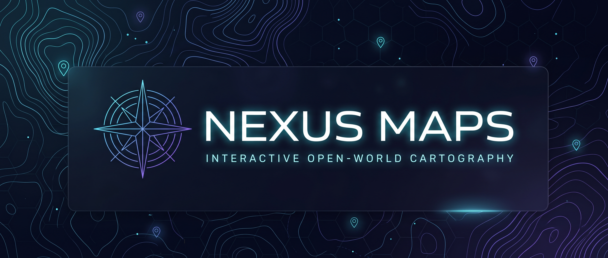

<br />
<br />

[](https://nexus-map-zeta.vercel.app)
[-06B6D4?style=for-the-badge&logo=windows&logoColor=white)](https://github.com/Luanserph/nexus-map/releases/latest)
[](https://github.com/Luanserph/nexus-map/releases/tag/v2.3.1)
[](https://github.com/Luanserph/nexus-map/actions/workflows/release.yml)
[](LICENSE)

<br />

**Central de cartografia interativa de alta performance para jogos de mundo aberto.**  
**69 jogos** • **152 mapas/camadas** • **168.644 marcadores** • Web (PWA) &amp; App Desktop Nativo para Windows (~12 MB)

</div>

---

## ✨ Por que o Nexus Maps?

O **Nexus Maps** foi criado para oferecer um único lugar rápido, limpo e sem distrações para acompanhar exploração **100%** em jogos de mundo aberto — seja no segundo monitor do PC, sobreposto ao jogo com atalho global, ou instalado no celular como PWA.

> [!TIP]
> **Modo Overlay no Windows:** no App Desktop (`Tauri v2`), pressione **`Alt + M`** a qualquer momento durante a gameplay para chamar ou ocultar o mapa instantaneamente, e use o botão **Fixar no Topo (Pin)** para mantê-lo sobreposto ao jogo. O instalador `.exe` está disponível na aba [**Releases**](https://github.com/Luanserph/nexus-map/releases/latest), compilado automaticamente via **GitHub Actions**.

---

## 🆕 Novidades da v2.3.0

- **Hub reorganizado:** header `sticky` minimalista em 1 linha, filtros de status horizontais e seletor de gêneros em dropdown padronizado (com busca e acentuação unificada).
- **Navegação multi-mapa aprimorada:** barra flutuante com botões laterais (`<` e `>`) quando há overflow, gradiente sutil nas bordas, rolagem horizontal direta com a rodinha do mouse (sem precisar de `Shift`) e centralização automática do mapa selecionado.
- **Indicador `Offline-First` ativo:** bolinha de status em tempo real (**esmeralda** online / **âmbar** offline via `navigator.onLine`), tooltip explicando o salvamento local sem necessidade de conta e clique abrindo o modal de **Exportar / Importar Backup (`.json`)**.
- **Versão dinâmica sincronizada:** selo do Atlas Interativo alimentado automaticamente pelo `package.json` (`__APP_VERSION__`).
- **Abertura instantânea e confiável:** inicialização do Leaflet condicionada a dimensões válidas via `ResizeObserver` + `invalidateSize()`, cancelamento limpo via `AbortController` e recuperação automática de chunks PWA (`vite:preloadError`).
- **Desktop Windows automatizado (Tauri v2):** build e publicação automática do instalador `.exe` na aba [**Releases**](https://github.com/Luanserph/nexus-map/releases/latest) via GitHub Actions.
- **Nova leva de jogos no catálogo:** *Tainted Grail: The Fall of Avalon*, *Borderlands 4*, *Hollow Knight: Silksong*, *Silent Hill f*, *Dying Light: The Beast* e *Baby Steps*, além de novos ícones semânticos por categoria.

---

## 🎮 Vitrine do Catálogo (69 Jogos • 152 Mapas • 168.644 Pins)

> Organizado em ordem alfabética com contagem real de mapas/camadas e pins extraída de `src/data/games/`.

<table>
  <tr>
    <td align="center" width="20%">
      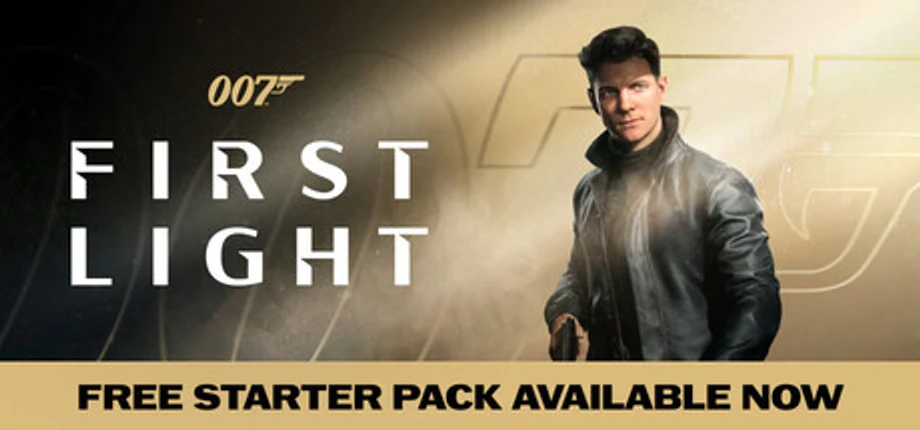<br />
      <b>007 First Light</b><br /><sub>8 mapas • 1.983 pins</sub>
    </td>
    <td align="center" width="20%">
      <br />
      <b>Assassin's Creed: Black Flag Resynced</b><br /><sub>1 mapa • 1.526 pins</sub>
    </td>
    <td align="center" width="20%">
      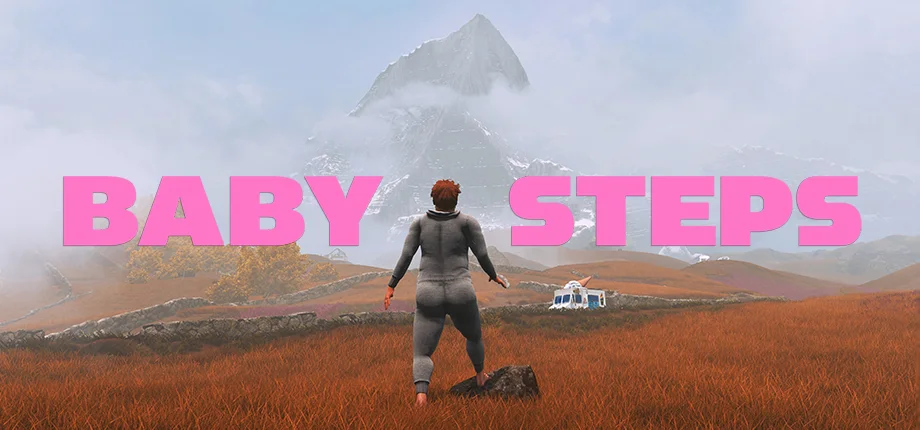<br />
      <b>Baby Steps</b><br /><sub>1 mapa • 215 pins</sub>
    </td>
    <td align="center" width="20%">
      <br />
      <b>Beast of Reincarnation</b><br /><sub>12 mapas • 1.273 pins</sub>
    </td>
    <td align="center" width="20%">
      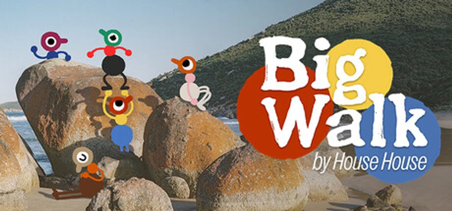<br />
      <b>Big Walk</b><br /><sub>1 mapa • 230 pins</sub>
    </td>
  </tr>
  <tr>
    <td align="center" width="20%">
      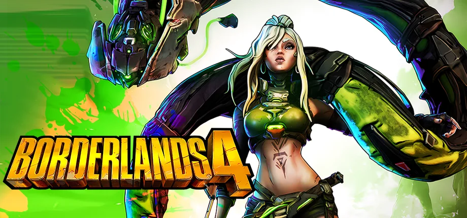<br />
      <b>Borderlands 4</b><br /><sub>3 mapas • 2.315 pins</sub>
    </td>
    <td align="center" width="20%">
      <br />
      <b>Call of Duty: Modern Warfare 4</b><br /><sub>2 mapas • 393 pins</sub>
    </td>
    <td align="center" width="20%">
      <br />
      <b>Call of Duty: Vanguard</b><br /><sub>4 mapas • 507 pins</sub>
    </td>
    <td align="center" width="20%">
      <br />
      <b>Castlevania: Belmont's Curse</b><br /><sub>1 mapa • 1.339 pins</sub>
    </td>
    <td align="center" width="20%">
      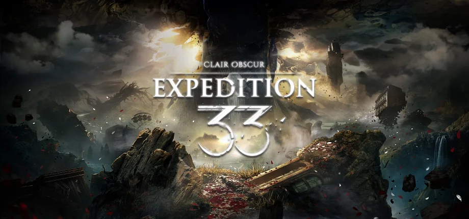<br />
      <b>Clair Obscur: Expedition 33</b><br /><sub>1 mapa • 2.815 pins</sub>
    </td>
  </tr>
  <tr>
    <td align="center" width="20%">
      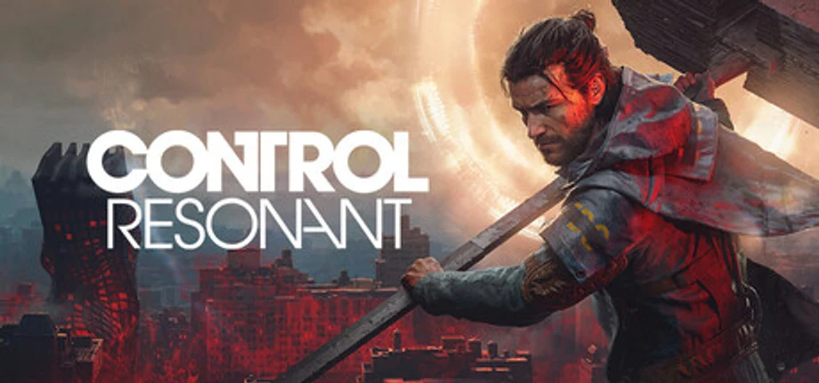<br />
      <b>Control Resonant</b><br /><sub>1 mapa • 2.121 pins</sub>
    </td>
    <td align="center" width="20%">
      <br />
      <b>Crimson Desert</b><br /><sub>1 mapa • 15.572 pins</sub>
    </td>
    <td align="center" width="20%">
      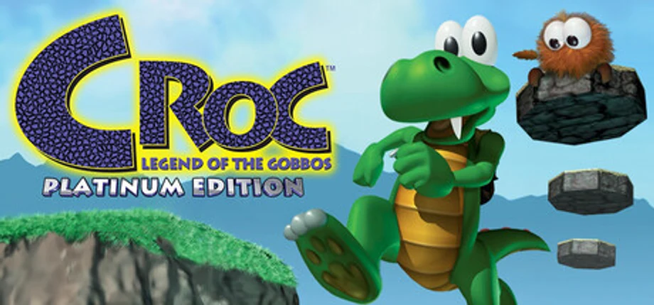<br />
      <b>Croc: Legend of the Gobbos</b><br /><sub>5 mapas • 2.322 pins</sub>
    </td>
    <td align="center" width="20%">
      <br />
      <b>Cyberpunk 2077</b><br /><sub>1 mapa • 2.754 pins</sub>
    </td>
    <td align="center" width="20%">
      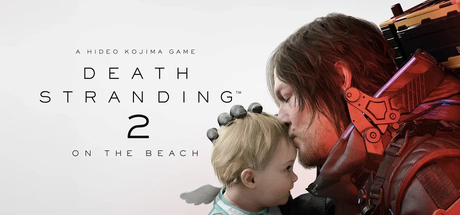<br />
      <b>Death Stranding 2: On the Beach</b><br /><sub>2 mapas • 336 pins</sub>
    </td>
  </tr>
  <tr>
    <td align="center" width="20%">
      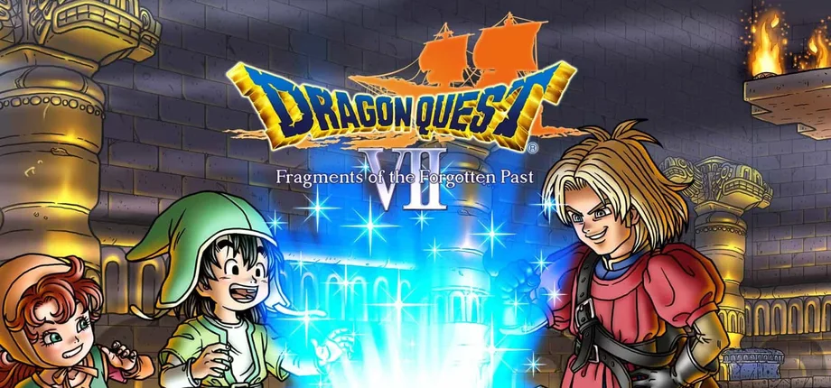<br />
      <b>Dragon Quest VII Reimagined</b><br /><sub>2 mapas • 3.656 pins</sub>
    </td>
    <td align="center" width="20%">
      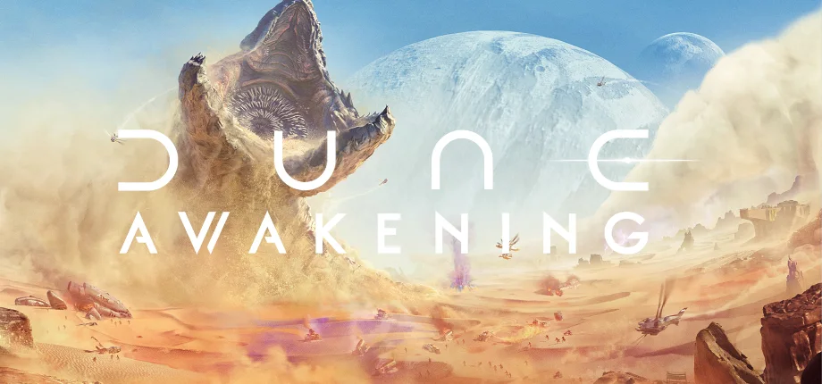<br />
      <b>Dune: Awakening</b><br /><sub>1 mapa • 980 pins</sub>
    </td>
    <td align="center" width="20%">
      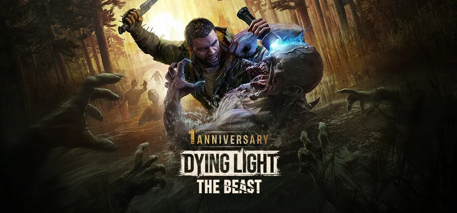<br />
      <b>Dying Light: The Beast</b><br /><sub>1 mapa • 422 pins</sub>
    </td>
    <td align="center" width="20%">
      <br />
      <b>Elden Ring</b><br /><sub>2 mapas • 7.578 pins</sub>
    </td>
    <td align="center" width="20%">
      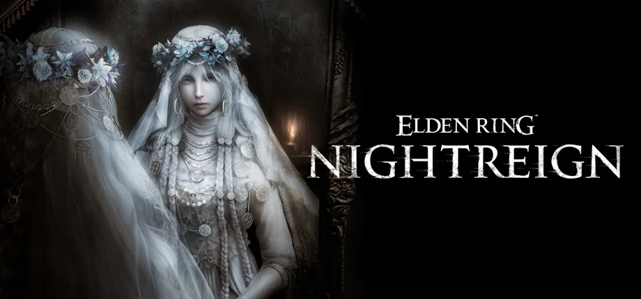<br />
      <b>Elden Ring Nightreign</b><br /><sub>1 mapa • 230 pins</sub>
    </td>
  </tr>
  <tr>
    <td align="center" width="20%">
      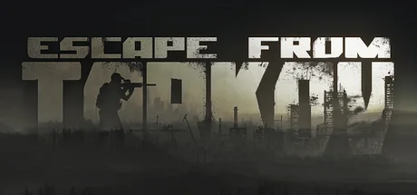<br />
      <b>Escape from Tarkov</b><br /><sub>5 mapas • 4.306 pins</sub>
    </td>
    <td align="center" width="20%">
      <br />
      <b>Final Fantasy Resonance</b><br /><sub>1 mapa • 1.317 pins</sub>
    </td>
    <td align="center" width="20%">
      <br />
      <b>Final Fantasy VII Rebirth</b><br /><sub>1 mapa • 1.949 pins</sub>
    </td>
    <td align="center" width="20%">
      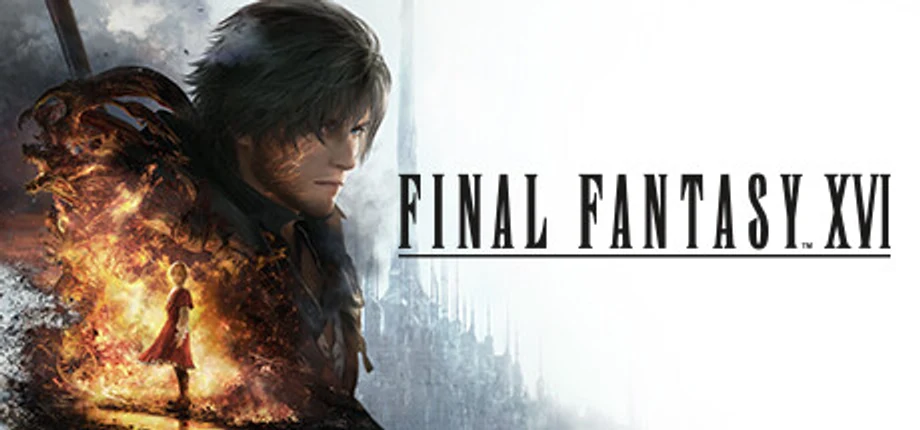<br />
      <b>Final Fantasy XVI</b><br /><sub>1 mapa • 943 pins</sub>
    </td>
    <td align="center" width="20%">
      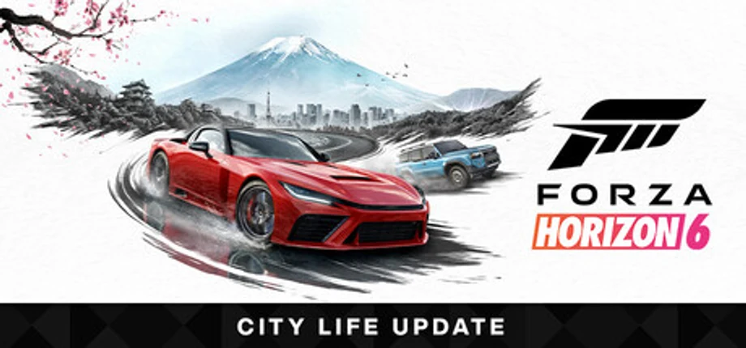<br />
      <b>Forza Horizon 6</b><br /><sub>1 mapa • 806 pins</sub>
    </td>
  </tr>
  <tr>
    <td align="center" width="20%">
      <br />
      <b>Goat Simulator 3</b><br /><sub>4 mapas • 1.876 pins</sub>
    </td>
    <td align="center" width="20%">
      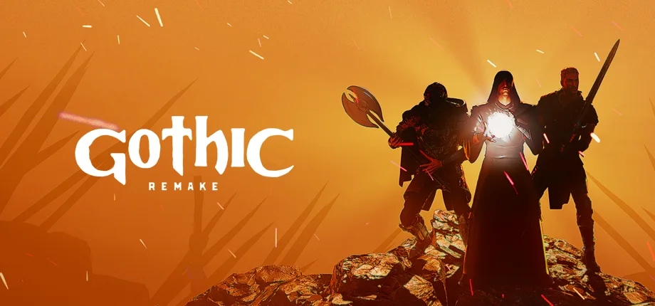<br />
      <b>Gothic 1 Remake</b><br /><sub>1 mapa • 1.714 pins</sub>
    </td>
    <td align="center" width="20%">
      <br />
      <b>Grand Theft Auto VI</b><br /><sub>1 mapa • 2.690 pins</sub>
    </td>
    <td align="center" width="20%">
      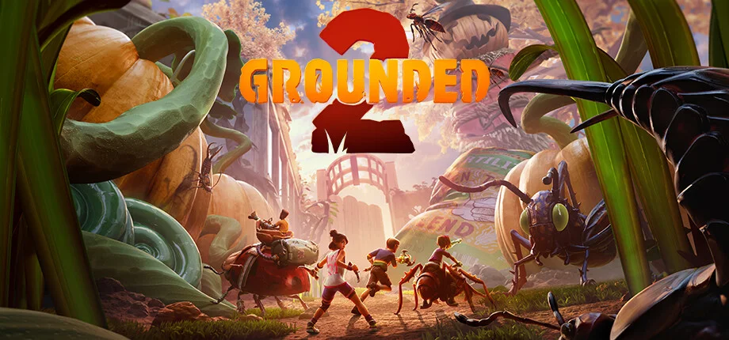<br />
      <b>Grounded 2</b><br /><sub>1 mapa • 11.899 pins</sub>
    </td>
    <td align="center" width="20%">
      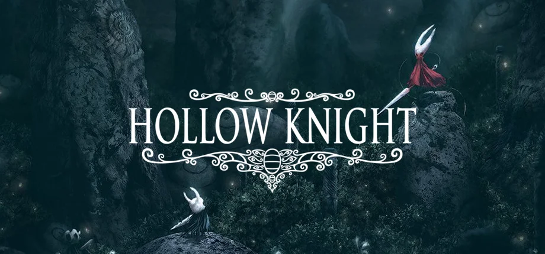<br />
      <b>Hollow Knight</b><br /><sub>1 mapa • 979 pins</sub>
    </td>
  </tr>
  <tr>
    <td align="center" width="20%">
      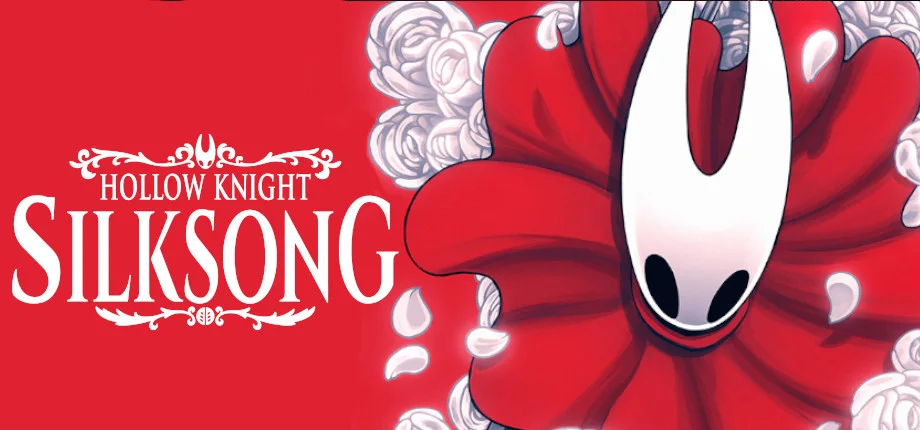<br />
      <b>Hollow Knight: Silksong</b><br /><sub>1 mapa • 1.939 pins</sub>
    </td>
    <td align="center" width="20%">
      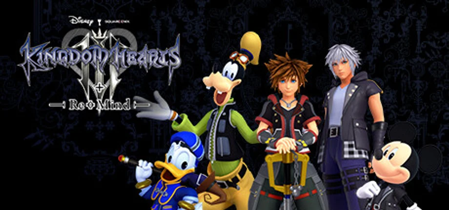<br />
      <b>Kingdom Hearts III</b><br /><sub>10 mapas • 822 pins</sub>
    </td>
    <td align="center" width="20%">
      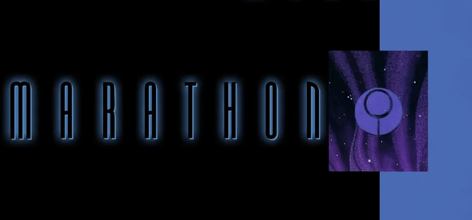<br />
      <b>Marathon</b><br /><sub>4 mapas • 530 pins</sub>
    </td>
    <td align="center" width="20%">
      <br />
      <b>Metal Gear Solid V: The Phantom Pain</b><br /><sub>2 mapas • 488 pins</sub>
    </td>
    <td align="center" width="20%">
      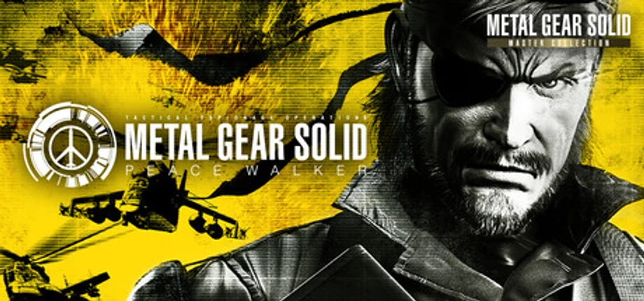<br />
      <b>Metal Gear Solid: Peace Walker</b><br /><sub>1 mapa • 659 pins</sub>
    </td>
  </tr>
  <tr>
    <td align="center" width="20%">
      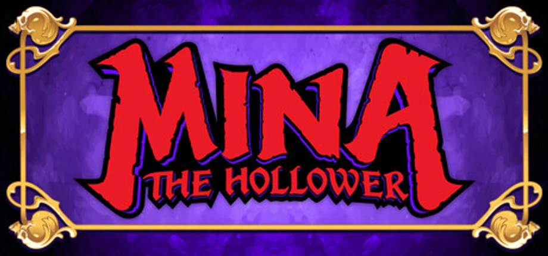<br />
      <b>Mina the Hollower</b><br /><sub>1 mapa • 1.584 pins</sub>
    </td>
    <td align="center" width="20%">
      <br />
      <b>Minecraft Dungeons II</b><br /><sub>1 mapa • 2.223 pins</sub>
    </td>
    <td align="center" width="20%">
      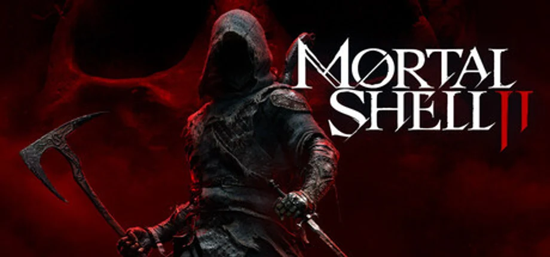<br />
      <b>Mortal Shell II</b><br /><sub>1 mapa • 1.724 pins</sub>
    </td>
    <td align="center" width="20%">
      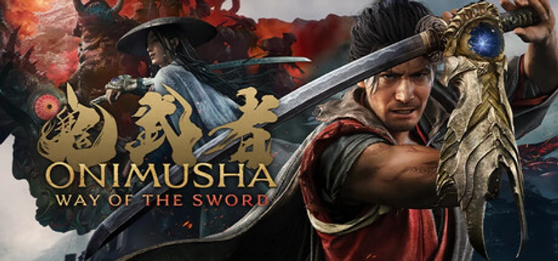<br />
      <b>Onimusha: Way of the Sword</b><br /><sub>9 mapas • 2.205 pins</sub>
    </td>
    <td align="center" width="20%">
      <br />
      <b>Phantom Blade Zero</b><br /><sub>8 mapas • 2.680 pins</sub>
    </td>
  </tr>
  <tr>
    <td align="center" width="20%">
      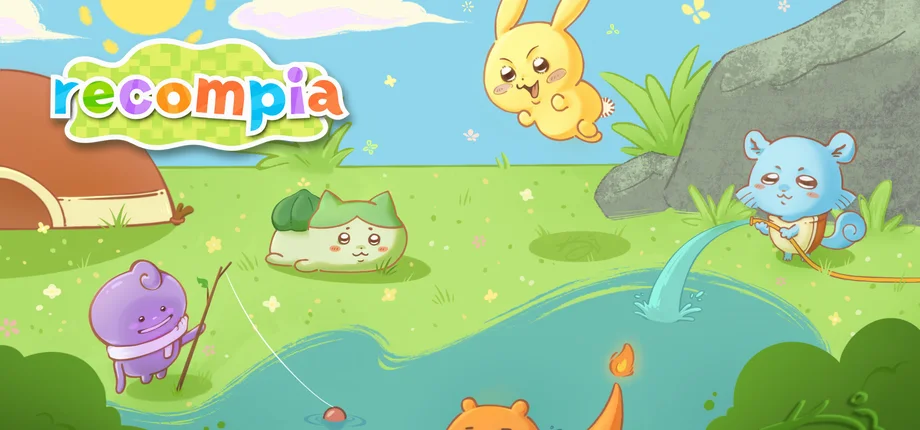<br />
      <b>Pokémon Pokopia</b><br /><sub>1 mapa • 2.531 pins</sub>
    </td>
    <td align="center" width="20%">
      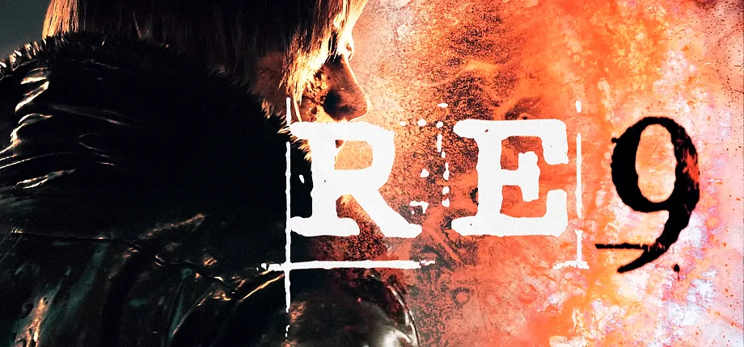<br />
      <b>Resident Evil Requiem</b><br /><sub>1 mapa • 1.145 pins</sub>
    </td>
    <td align="center" width="20%">
      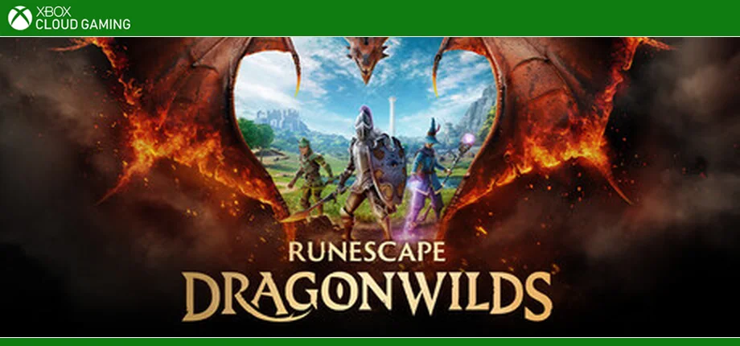<br />
      <b>RuneScape: Dragonwilds</b><br /><sub>1 mapa • 6.092 pins</sub>
    </td>
    <td align="center" width="20%">
      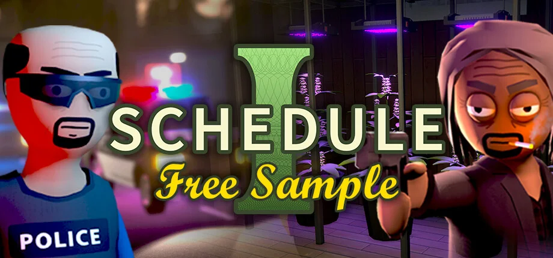<br />
      <b>Schedule I</b><br /><sub>1 mapa • 226 pins</sub>
    </td>
    <td align="center" width="20%">
      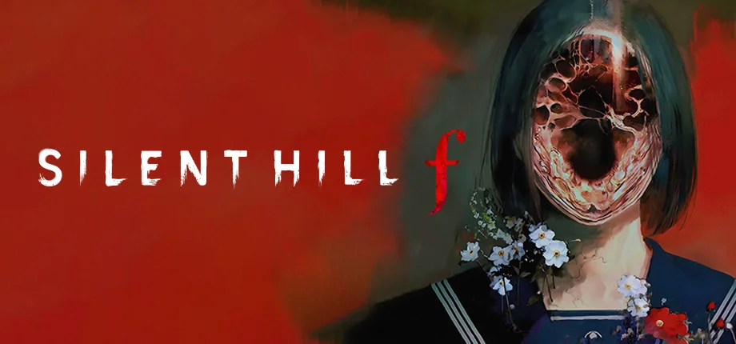<br />
      <b>Silent Hill f</b><br /><sub>1 mapa • 1.057 pins</sub>
    </td>
  </tr>
  <tr>
    <td align="center" width="20%">
      <br />
      <b>Silent Hill: Townfall</b><br /><sub>1 mapa • 844 pins</sub>
    </td>
    <td align="center" width="20%">
      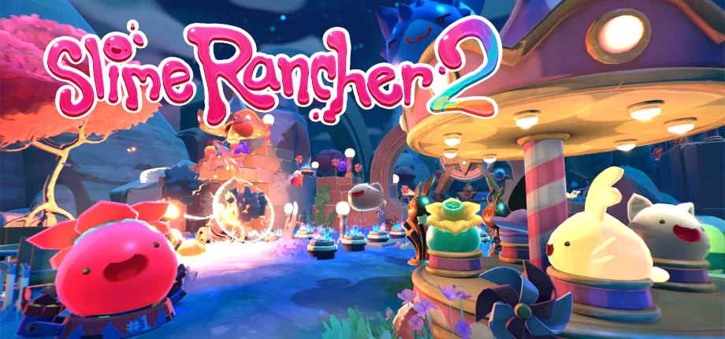<br />
      <b>Slime Rancher 2</b><br /><sub>1 mapa • 285 pins</sub>
    </td>
    <td align="center" width="20%">
      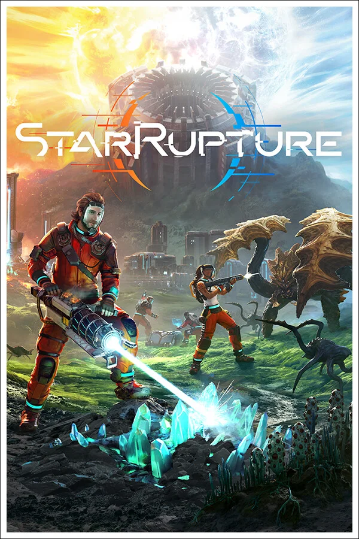<br />
      <b>StarRupture</b><br /><sub>1 mapa • 2.436 pins</sub>
    </td>
    <td align="center" width="20%">
      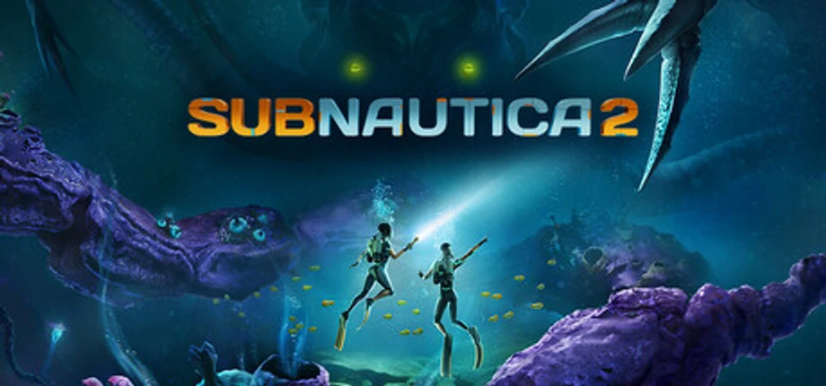<br />
      <b>Subnautica 2</b><br /><sub>1 mapa • 8.047 pins</sub>
    </td>
    <td align="center" width="20%">
      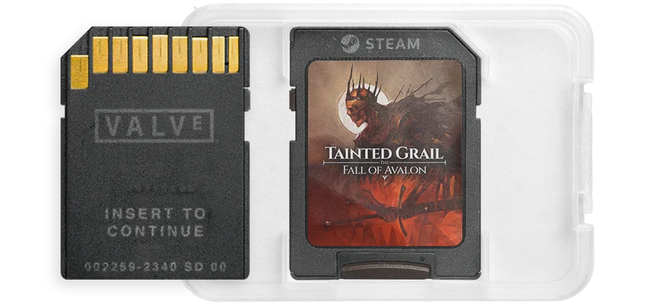<br />
      <b>Tainted Grail: The Fall of Avalon</b><br /><sub>3 mapas • 3.809 pins</sub>
    </td>
  </tr>
  <tr>
    <td align="center" width="20%">
      <br />
      <b>The Adventures of Elliot: The Millennium Tales</b><br /><sub>4 mapas • 2.303 pins</sub>
    </td>
    <td align="center" width="20%">
      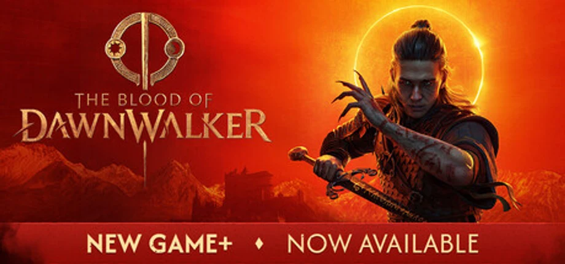<br />
      <b>The Blood of Dawnwalker</b><br /><sub>1 mapa • 719 pins</sub>
    </td>
    <td align="center" width="20%">
      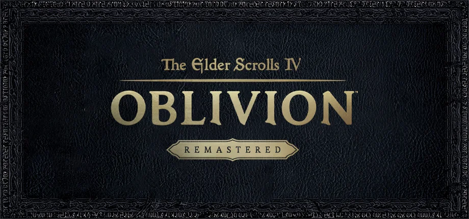<br />
      <b>The Elder Scrolls IV: Oblivion Remastered</b><br /><sub>2 mapas • 1.703 pins</sub>
    </td>
    <td align="center" width="20%">
      <br />
      <b>The Legend of Zelda</b><br /><sub>2 mapas • 545 pins</sub>
    </td>
    <td align="center" width="20%">
      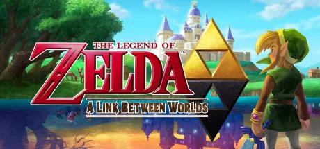<br />
      <b>The Legend of Zelda: A Link Between Worlds</b><br /><sub>1 mapa • 332 pins</sub>
    </td>
  </tr>
  <tr>
    <td align="center" width="20%">
      <br />
      <b>The Legend of Zelda: A Link to the Past</b><br /><sub>1 mapa • 815 pins</sub>
    </td>
    <td align="center" width="20%">
      <br />
      <b>The Legend of Zelda: Breath of the Wild</b><br /><sub>1 mapa • 16.504 pins</sub>
    </td>
    <td align="center" width="20%">
      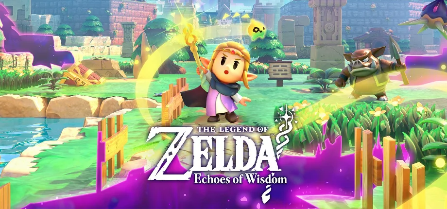<br />
      <b>The Legend of Zelda: Echoes of Wisdom</b><br /><sub>1 mapa • 696 pins</sub>
    </td>
    <td align="center" width="20%">
      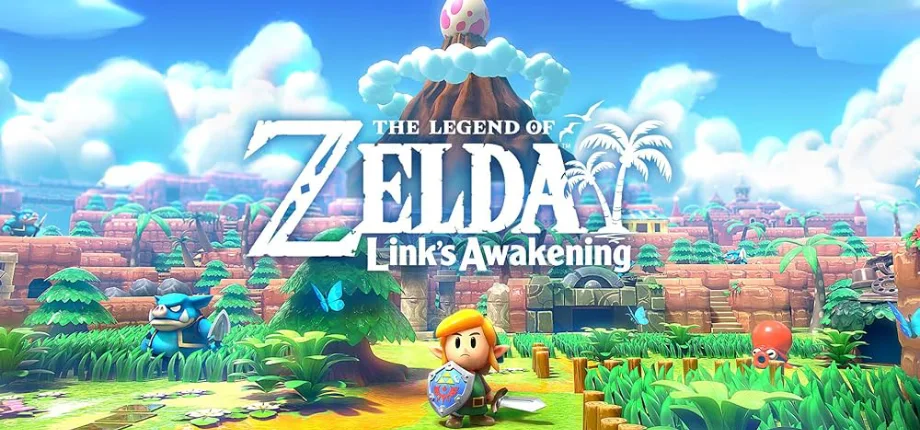<br />
      <b>The Legend of Zelda: Link's Awakening</b><br /><sub>1 mapa • 409 pins</sub>
    </td>
    <td align="center" width="20%">
      <br />
      <b>The Legend of Zelda: Ocarina of Time</b><br /><sub>2 mapas • 3.218 pins</sub>
    </td>
  </tr>
  <tr>
    <td align="center" width="20%">
      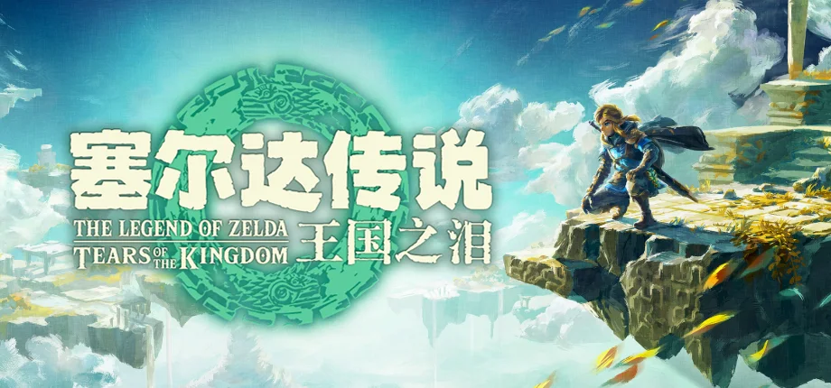<br />
      <b>The Legend of Zelda: Tears of the Kingdom</b><br /><sub>1 mapa • 7.956 pins</sub>
    </td>
    <td align="center" width="20%">
      <br />
      <b>The Legend of Zelda: The Wind Waker</b><br /><sub>1 mapa • 1.232 pins</sub>
    </td>
    <td align="center" width="20%">
      <br />
      <b>The Witcher 3: Wild Hunt</b><br /><sub>6 mapas • 3.000 pins</sub>
    </td>
    <td align="center" width="20%">
      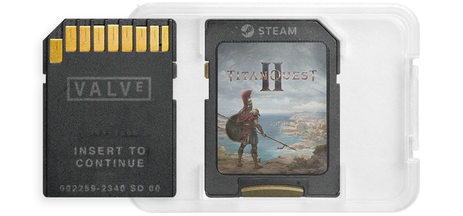<br />
      <b>Titan Quest II</b><br /><sub>3 mapas • 1.311 pins</sub>
    </td>
    <td align="center" width="20%">
      <br />
      <b>Tom Clancy's Ghost Recon Wildlands</b><br /><sub>2 mapas • 2.528 pins</sub>
    </td>
  </tr>
  <tr>
    <td align="center" width="20%">
      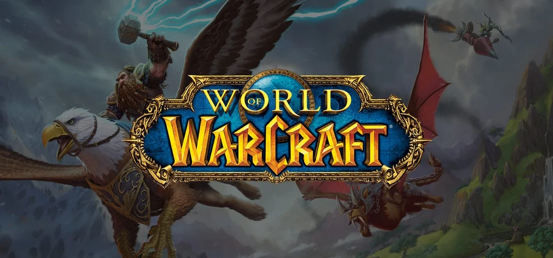<br />
      <b>World of Warcraft: Forever</b><br /><sub>1 mapa • 6.054 pins</sub>
    </td>
    <td align="center" width="20%">
      <br />
      <b>Yakuza 0 Director's Cut</b><br /><sub>2 mapas • 433 pins</sub>
    </td>
    <td align="center" width="20%">
      <br />
      <b>Yakuza Kiwami</b><br /><sub>1 mapa • 256 pins</sub>
    </td>
    <td align="center" width="20%">
      <br />
      <b>Zelda II: The Adventure of Link</b><br /><sub>1 mapa • 258 pins</sub>
    </td>
    <td align="center" width="20%"></td>
  </tr>
</table>

---

## ⚡ Recursos Principais

| Recurso | Descrição |
| :--- | :--- |
| 🗺️ **Motor `EPSG:3857` sob Demanda** | Pirâmides de tiles externas, polígonos de regiões em GeoJSON, `ResizeObserver` + `invalidateSize()` e **lazy-load por jogo** (bundle inicial leve, sem travar o navegador). |
| 🎯 **Ícones Semânticos em Cache** | Pins categorizados automaticamente (baús, chefes, shrines, NPCs, missões, extrações, colecionáveis) reutilizados em cache `L.divIcon` para manter 60 FPS mesmo com +16.000 pins. |
| 🧭 **Navegação Multi-Mapa Fluida** | Barra de camadas com botões laterais `<` / `>`, gradiente de overflow, rolagem horizontal com a rodinha do mouse (sem `Shift`) e centralização automática do mapa ativo. |
| 🌗 **Camadas em Tempo Real** | Alternância instantânea de estilos visuais no mesmo mapa (como **Dia / Noite** em *GTA VI* e **Superfície / Subterrâneo** em *Elden Ring*). |
| 💾 **Offline-First & Backup Local** | Progresso, notas, prints e rotas salvos localmente em IndexedDB (`Dexie.js`), com indicador de conexão online/offline em tempo real e exportação/importação `.json` sem necessidade de conta. |
| 🖥️ **App Desktop Nativo (Tauri v2)** | Executável leve (~12 MB) para Windows compilado via GitHub Actions, com atalho global **`Alt + M`**, modo **Sempre no Topo** e salvamento nativo em `%APPDATA%\com.nexusmaps.desktop\progress.json`. |
| 📱 **Mobile & PWA Instalável** | Interface responsiva para Android/iOS com instalação em janela própria e recuperação automática de atualizações do Service Worker. |
| 🌍 **Multi-idioma (i18n)** | Suporte completo para **Português (`pt-BR`)**, **Inglês (`en-US`)** e **Espanhol (`es-ES`)**. |

---

## 🛠️ Stack Tecnológica

<div align="center">


</div>

---

<details>
<summary><b>🚀 Como rodar localmente (Web &amp; Desktop Tauri v2)</b></summary>

<br />

### Pré-requisitos
* **Node.js 18+** e **npm**
* *(Apenas para compilar o App Desktop)* **Rust + Cargo** e **Visual Studio C++ Build Tools**

```bash
# 1. Clone o repositório
git clone https://github.com/Luanserph/nexus-map.git
cd nexus-map

# 2. Instale as dependências
npm install

# 3. Rode a versão Web em desenvolvimento
npm run dev

# 4. Rode a versão Desktop (Tauri v2)
npm run tauri:dev

# 5. Gere o instalador Windows (.exe / .msi)
npm run tauri:build
```

</details>

---

## 🧭 Roadmap

- [x] Motor de mapas `EPSG:3857` com clustering (`chunkedLoading`), polígonos GeoJSON e `ResizeObserver`
- [x] Persistência offline-first (IndexedDB / Dexie.js) com indicador de status online/offline e backup `.json`
- [x] Hub reorganizado (header sticky em 1 linha, filtros horizontais e dropdown de gêneros padronizado)
- [x] Barra multi-mapa com setas laterais, rolagem horizontal via mouse wheel e centralização automática
- [x] Layout responsivo para Mobile e PWA instalável com recuperação automática de chunks
- [x] Ícones semânticos em cache por categoria na sidebar e nos pins do mapa
- [x] **App Desktop nativo para Windows (Tauri v2)** com atalho global `Alt + M`, *Sempre no Topo*, persistência em `%APPDATA%\progress.json` e build automático via GitHub Actions
- [ ] Expansão contínua do catálogo ([veja como adicionar novos jogos](./docs/ADDING_GAMES.md))
- [ ] Sincronização em nuvem opcional entre Desktop e Mobile

---

## 🧩 Adicionando Novos Jogos

O catálogo é 100% orientado a manifesto (`src/data/games/<slug>/manifest.json`). Para adicionar novos jogos usando o pipeline automatizado, consulte [**`docs/ADDING_GAMES.md`**](./docs/ADDING_GAMES.md).

---

## 📄 Licença

Distribuído sob a licença **MIT**. Consulte [LICENSE](./LICENSE) para mais detalhes.
