<div align="center">


<br />
<br />

[](https://nexus-map-zeta.vercel.app)
[-06B6D4?style=for-the-badge&logo=windows&logoColor=white)](https://github.com/Luanserph/nexus-map/releases/latest)
[](https://github.com/Luanserph/nexus-map/releases/tag/v2.2.0)
[](LICENSE)

<br />

**Central de cartografia interativa de alta performance para jogos de mundo aberto.**  
46 jogos • ~117.000 marcadores • Web (PWA) & App Desktop Nativo para Windows (~12 MB)

</div>

---

## ✨ Por que o Nexus Maps?

O **Nexus Maps** foi criado para oferecer um único lugar rápido, limpo e sem distrações para acompanhar exploração **100%** em jogos de mundo aberto — seja no segundo monitor do PC, sobreposto ao jogo com atalho global, ou instalado no celular como PWA.

> [!TIP]
> **Modo Overlay no Windows:** no App Desktop (`Tauri v2`), pressione **`Alt + M`** a qualquer momento durante a gameplay para chamar ou ocultar o mapa instantaneamente, e use o botão **Fixar no Topo (Pin)** para mantê-lo sobreposto ao jogo.

---

## 🎮 Vitrine do Catálogo (46 Jogos • 116.692 Pins)

<table>
  <tr>
    <td align="center" width="20%">
      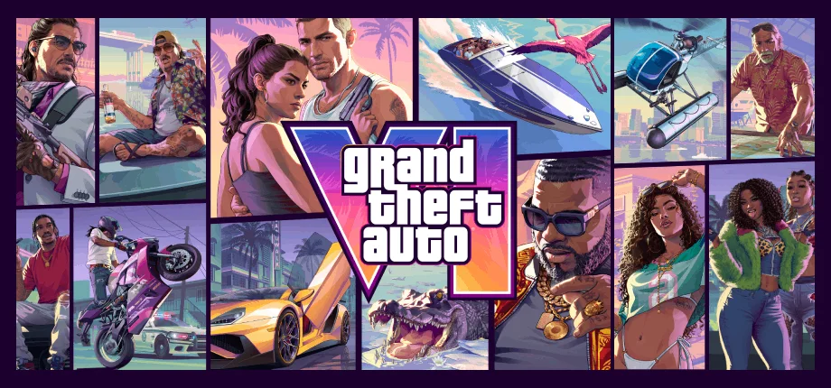<br />
      <b>GTA VI</b><br /><sub>Leonida (Dia/Noite) • 2.690 pins</sub>
    </td>
    <td align="center" width="20%">
      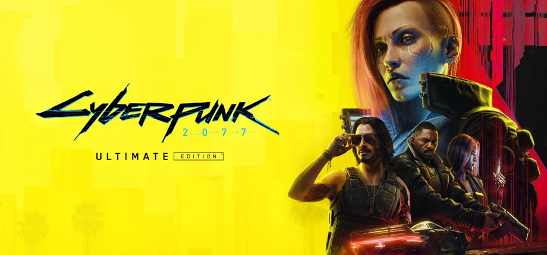<br />
      <b>Cyberpunk 2077</b><br /><sub>Night City • 2.754 pins</sub>
    </td>
    <td align="center" width="20%">
      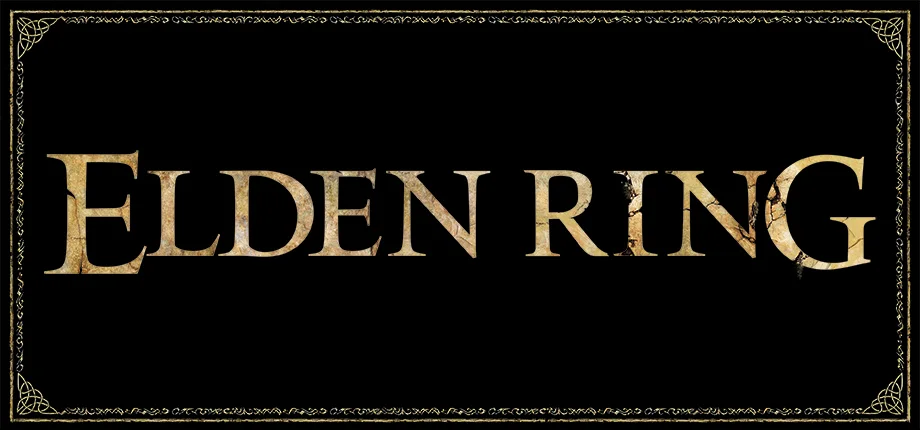<br />
      <b>Elden Ring</b><br /><sub>Base + DLC • 7.578 pins</sub>
    </td>
    <td align="center" width="20%">
      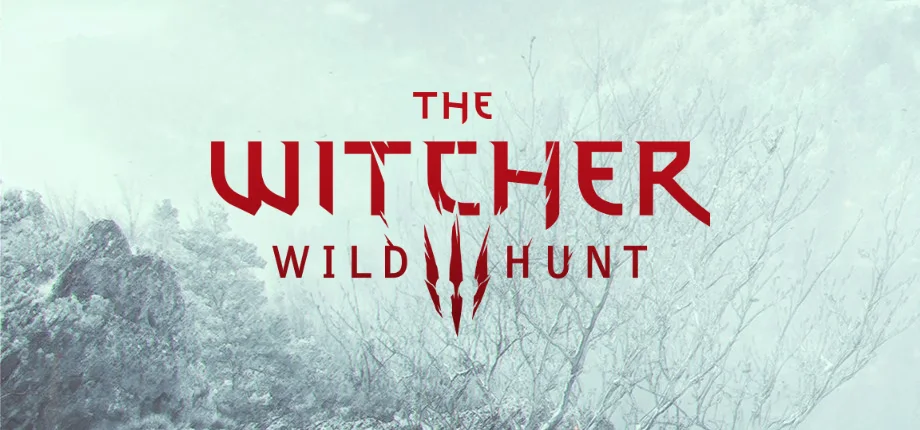<br />
      <b>The Witcher 3</b><br /><sub>6 Regiões • 3.000 pins</sub>
    </td>
    <td align="center" width="20%">
      <br />
      <b>Hollow Knight</b><br /><sub>Hallownest • 979 pins</sub>
    </td>
  </tr>
  <tr>
    <td align="center" width="20%">
      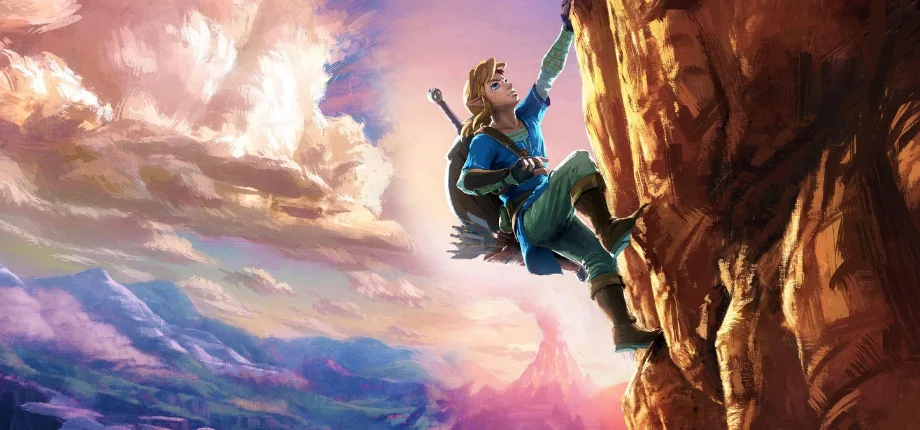<br />
      <b>Zelda: BotW</b><br /><sub>Hyrule • 16.504 pins</sub>
    </td>
    <td align="center" width="20%">
      <br />
      <b>Zelda: TotK</b><br /><sub>Hyrule • 7.956 pins</sub>
    </td>
    <td align="center" width="20%">
      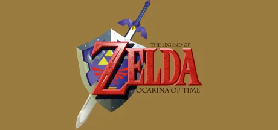<br />
      <b>Ocarina of Time</b><br /><sub>Past &amp; Future • 3.218 pins</sub>
    </td>
    <td align="center" width="20%">
      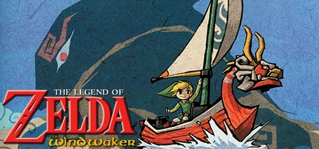<br />
      <b>The Wind Waker</b><br /><sub>Great Sea • 1.232 pins</sub>
    </td>
    <td align="center" width="20%">
      <br />
      <b>Echoes of Wisdom</b><br /><sub>Hyrule • 696 pins</sub>
    </td>
  </tr>
  <tr>
    <td align="center" width="20%">
      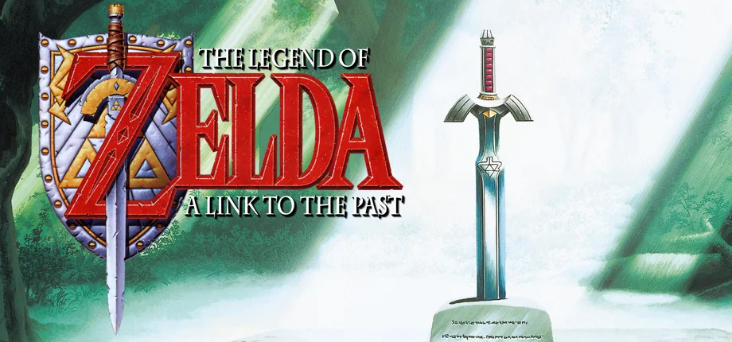<br />
      <b>A Link to the Past</b><br /><sub>World • 815 pins</sub>
    </td>
    <td align="center" width="20%">
      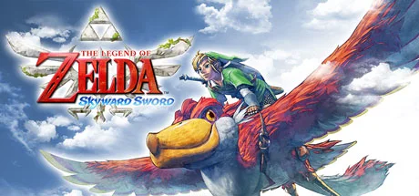<br />
      <b>Zelda (1986)</b><br /><sub>1st &amp; 2nd Quest • 545 pins</sub>
    </td>
    <td align="center" width="20%">
      <br />
      <b>Link's Awakening</b><br /><sub>Koholint • 409 pins</sub>
    </td>
    <td align="center" width="20%">
      <br />
      <b>A Link Between Worlds</b><br /><sub>Hyrule &amp; Lorule • 332 pins</sub>
    </td>
    <td align="center" width="20%">
      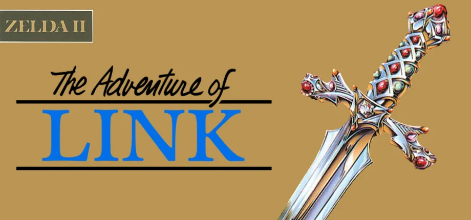<br />
      <b>Zelda II</b><br /><sub>Hyrule • 258 pins</sub>
    </td>
  </tr>
  <tr>
    <td align="center" width="20%">
      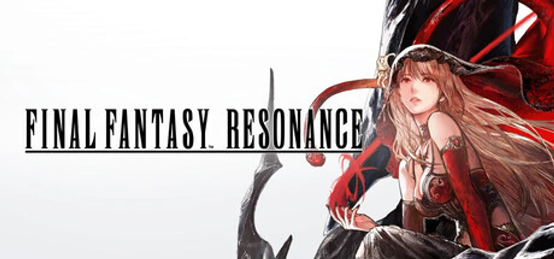<br />
      <b>Final Fantasy Resonance</b><br /><sub>Lapis • 1.317 pins</sub>
    </td>
    <td align="center" width="20%">
      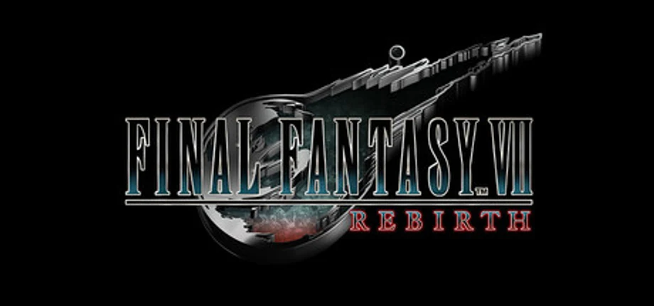<br />
      <b>Final Fantasy VII Rebirth</b><br /><sub>1.949 pins</sub>
    </td>
    <td align="center" width="20%">
      <br />
      <b>Final Fantasy XVI</b><br /><sub>Valisthea • 943 pins</sub>
    </td>
    <td align="center" width="20%">
      <br />
      <b>WoW: Forever</b><br /><sub>Azeroth • 6.054 pins</sub>
    </td>
    <td align="center" width="20%">
      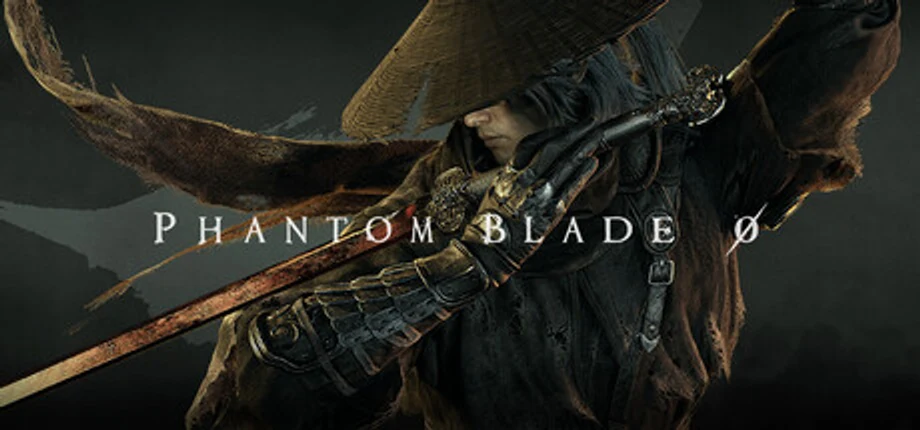<br />
      <b>Phantom Blade Zero</b><br /><sub>8 Regiões • 2.680 pins</sub>
    </td>
  </tr>
  <tr>
    <td align="center" width="20%">
      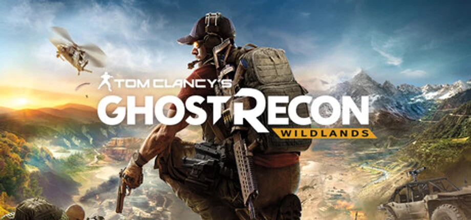<br />
      <b>Ghost Recon Wildlands</b><br /><sub>Bolívia + DLCs • 2.528 pins</sub>
    </td>
    <td align="center" width="20%">
      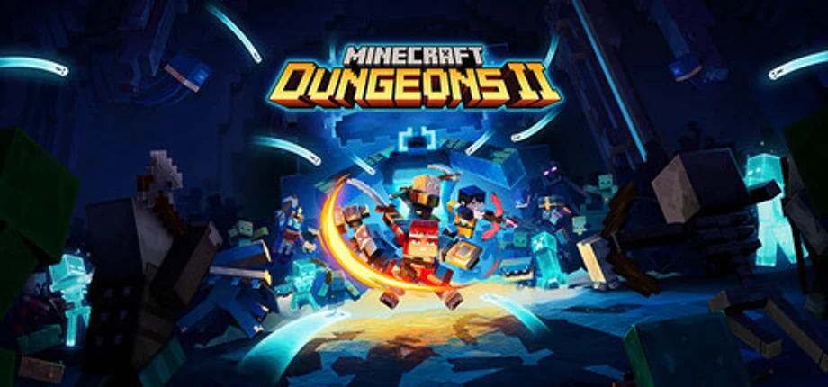<br />
      <b>Minecraft Dungeons II</b><br /><sub>Overworld • 2.223 pins</sub>
    </td>
    <td align="center" width="20%">
      <br />
      <b>Onimusha</b><br /><sub>9 Regiões • 2.205 pins</sub>
    </td>
    <td align="center" width="20%">
      <br />
      <b>Control Resonant</b><br /><sub>Manhattan • 2.121 pins</sub>
    </td>
    <td align="center" width="20%">
      <br />
      <b>Mortal Shell II</b><br /><sub>Fallgrim • 1.724 pins</sub>
    </td>
  </tr>
  <tr>
    <td align="center" width="20%">
      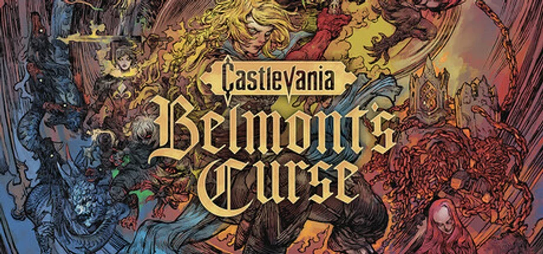<br />
      <b>Castlevania</b><br /><sub>Streets of Paris • 1.339 pins</sub>
    </td>
    <td align="center" width="20%">
      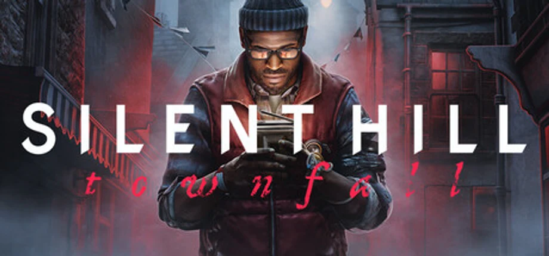<br />
      <b>Silent Hill: Townfall</b><br /><sub>St. Amelia • 844 pins</sub>
    </td>
    <td align="center" width="20%">
      <br />
      <b>Kingdom Hearts III</b><br /><sub>10 Mundos • 822 pins</sub>
    </td>
    <td align="center" width="20%">
      <br />
      <b>Blood of Dawnwalker</b><br /><sub>Vale Sangora • 719 pins</sub>
    </td>
    <td align="center" width="20%">
      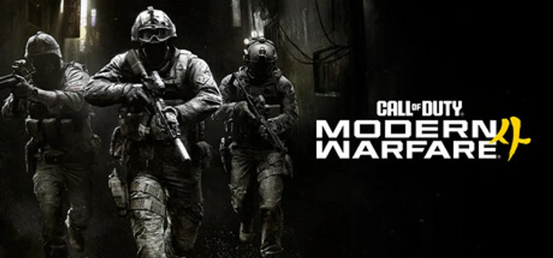<br />
      <b>CoD: Modern Warfare 4</b><br /><sub>Campanha &amp; DMZ • 393 pins</sub>
    </td>
  </tr>
  <tr>
    <td align="center" width="20%">
      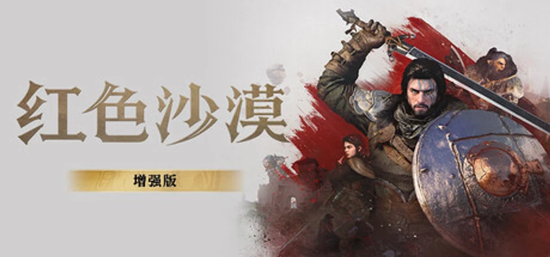<br />
      <b>Crimson Desert</b><br /><sub>Pywel • 15.572 pins</sub>
    </td>
    <td align="center" width="20%">
      <br />
      <b>Subnautica 2</b><br /><sub>Mundo Subaquático • 8.047 pins</sub>
    </td>
    <td align="center" width="20%">
      <br />
      <b>Croc: Gobbos</b><br /><sub>5 Ilhas • 2.322 pins</sub>
    </td>
    <td align="center" width="20%">
      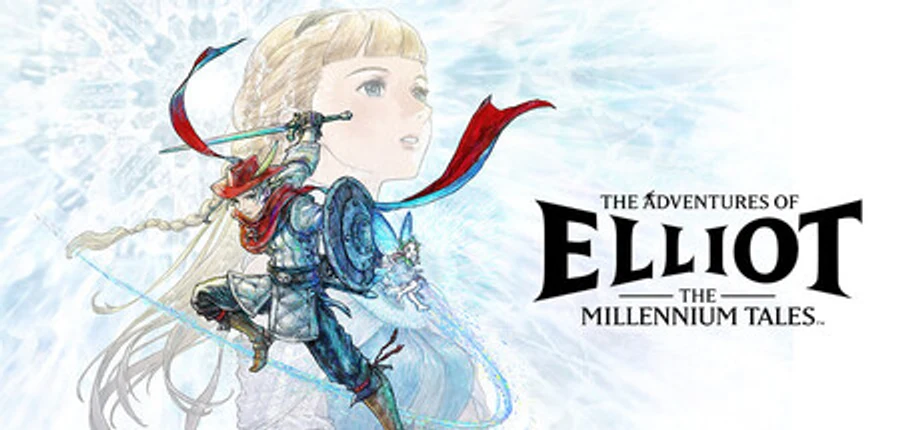<br />
      <b>Adventures of Elliot</b><br /><sub>4 Eras • 2.303 pins</sub>
    </td>
    <td align="center" width="20%">
      <br />
      <b>007 First Light</b><br /><sub>8 Missões • 1.983 pins</sub>
    </td>
  </tr>
  <tr>
    <td align="center" width="20%">
      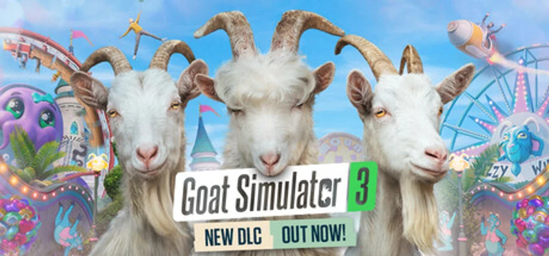<br />
      <b>Goat Simulator 3</b><br /><sub>4 Mapas • 1.876 pins</sub>
    </td>
    <td align="center" width="20%">
      <br />
      <b>Mina the Hollower</b><br /><sub>Tenebrous Isle • 1.584 pins</sub>
    </td>
    <td align="center" width="20%">
      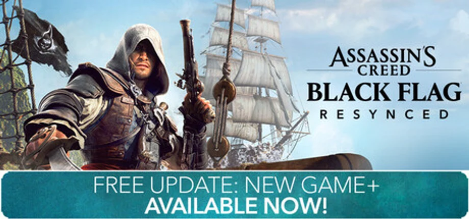<br />
      <b>AC: Black Flag Resynced</b><br /><sub>Caribbean Sea • 1.526 pins</sub>
    </td>
    <td align="center" width="20%">
      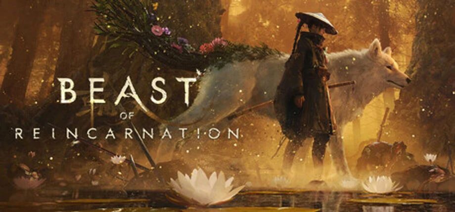<br />
      <b>Beast of Reincarnation</b><br /><sub>12 Zonas • 1.273 pins</sub>
    </td>
    <td align="center" width="20%">
      <br />
      <b>Forza Horizon 6</b><br /><sub>Japão • 806 pins</sub>
    </td>
  </tr>
  <tr>
    <td align="center" width="20%">
      <br />
      <b>MGS: Peace Walker</b><br /><sub>Costa Rica • 659 pins</sub>
    </td>
    <td align="center" width="20%">
      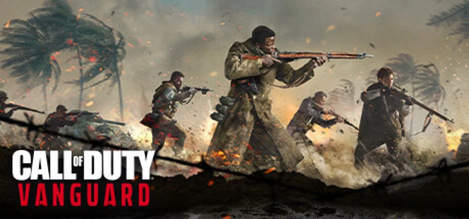<br />
      <b>CoD: Vanguard</b><br /><sub>4 Mapas Zombies • 507 pins</sub>
    </td>
    <td align="center" width="20%">
      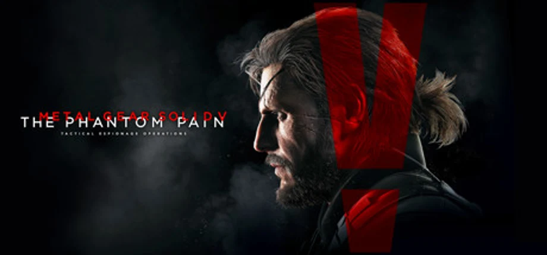<br />
      <b>MGSV: Phantom Pain</b><br /><sub>Afeganistão &amp; África • 488 pins</sub>
    </td>
    <td align="center" width="20%">
      <br />
      <b>Yakuza 0 Director's Cut</b><br /><sub>2 Cidades • 433 pins</sub>
    </td>
    <td align="center" width="20%">
      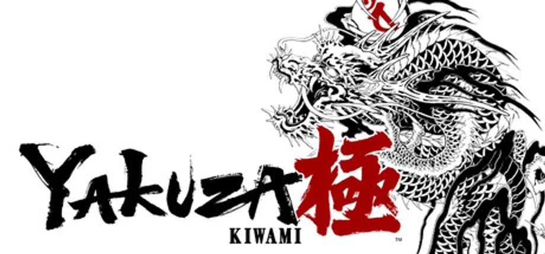<br />
      <b>Yakuza Kiwami</b><br /><sub>Kamurocho • 256 pins</sub>
    </td>
  </tr>
  <tr>
    <td align="center" width="20%">
      <br />
      <b>Big Walk</b><br /><sub>The Island • 230 pins</sub>
    </td>
    <td align="center" width="20%"></td>
    <td align="center" width="20%"></td>
    <td align="center" width="20%"></td>
    <td align="center" width="20%"></td>
  </tr>
</table>

---

## ⚡ Recursos Principais

| Recurso | Descrição |
| :--- | :--- |
| 🗺️ **Motor `EPSG:3857` sob Demanda** | Pirâmides de tiles externas, polígonos de regiões em GeoJSON e **lazy-load por jogo** (carregamento inicial leve, sem travar o navegador). |
| 🎯 **Ícones Semânticos em Cache** | Pins categorizados automaticamente (baús, chefes, shrines, NPCs, missões, colecionáveis) reutilizados em cache `L.divIcon` para manter 60 FPS mesmo com +16.000 pins. |
| 🌗 **Camadas em Tempo Real** | Alternância instantânea de estilos visuais no mesmo mapa (como **Dia / Noite** em *GTA VI* e **Superfície / Subterrâneo** em *Elden Ring*). |
| 🖥️ **App Desktop Nativo (Tauri v2)** | Executável leve (~12 MB) para Windows com atalho global **`Alt + M`**, modo **Sempre no Topo** e salvamento nativo em `%APPDATA%\com.nexusmaps.desktop\progress.json`. |
| 📱 **Mobile & PWA Instalável** | Interface responsiva para Android/iOS com backup e restauração de progresso via arquivo `.json` entre PC e celular. |
| 🌍 **Multi-idioma (i18n)** | Suporte completo para **Português (`pt-BR`)**, **Inglês (`en-US`)** e **Espanhol (`es-ES`)**. |

---

## 🛠️ Stack Tecnológica

<div align="center">


</div>

---

<details>
<summary><b>🚀 Como rodar localmente (Web &amp; Desktop Tauri v2)</b></summary>

<br />

### Pré-requisitos
* **Node.js 18+** e **npm**
* *(Apenas para compilar o App Desktop)* **Rust + Cargo** e **Visual Studio C++ Build Tools**

```bash
# 1. Clone o repositório
git clone https://github.com/Luanserph/nexus-map.git
cd nexus-map

# 2. Instale as dependências
npm install

# 3. Rode a versão Web em desenvolvimento
npm run dev

# 4. Rode a versão Desktop (Tauri v2)
npm run tauri:dev

# 5. Gere o instalador Windows (.exe / .msi)
npm run tauri:build
```

</details>

---

## 🧭 Roadmap

- [x] Motor de mapas `EPSG:3857` com clustering (`chunkedLoading`) e polígonos GeoJSON
- [x] Persistência offline-first (IndexedDB / Dexie.js) com backup e restauração `.json`
- [x] Layout responsivo para Mobile e PWA instalável
- [x] Coleção completa de 10 jogos de **The Legend of Zelda** + lazy-load de datasets por jogo
- [x] Ícones semânticos em cache por categoria na sidebar e nos pins do mapa
- [x] **App Desktop nativo para Windows (Tauri v2)** com atalho global `Alt + M`, *Sempre no Topo* e persistência em `%APPDATA%\progress.json`
- [ ] Expansão contínua do catálogo ([veja como adicionar novos jogos](./docs/ADDING_GAMES.md))
- [ ] Sincronização em nuvem opcional entre Desktop e Mobile

---

## 🧩 Adicionando Novos Jogos

O catálogo é 100% orientado a manifesto (`src/data/games/<slug>/manifest.json`). Para adicionar novos jogos usando o pipeline automatizado, consulte [**`docs/ADDING_GAMES.md`**](./docs/ADDING_GAMES.md).

---

## 📄 Licença

Distribuído sob a licença **MIT**. Consulte [LICENSE](./LICENSE) para mais detalhes.
